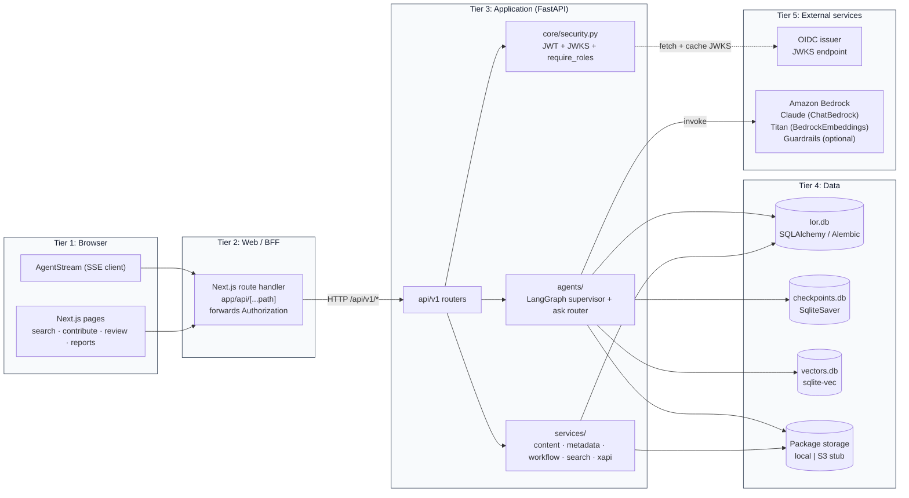

# Architecture

## Diagram

## Legend

| Symbol | Meaning |
| --- | --- |
| Solid arrow | Synchronous request or data access in the request path |
| Dotted arrow | Background or cached call (JWKS fetch, cached per `OIDC_JWKS_CACHE_SECONDS`) |
| Cylinder | Persistent store (SQLite file today; PostgreSQL is the production target) |
| Subgraph | Tier boundary. Only Tier 2 may talk to Tier 3, and only Tier 3 may talk to Tiers 4 and 5 |

Tier boundaries are enforced by configuration:

- Browsers never call FastAPI directly. The Next.js route handler is the only path, so the
  backend URL stays server-side.
- Only the application tier holds Bedrock access. It uses the AWS credential chain (IAM role in
  AWS), so no keys live in the code or the browser.
- Authorization happens in the backend. The frontend hides links for convenience only.

## Request flow 1: contributor ingest with reviewer interrupt

1. A Contributor uploads a package through `POST /api/v1/content`. The package is stored and the
   learning object is created in `draft`. An audit row is written.
2. The Contributor calls `POST /api/v1/agents/ingest/{lo_id}`. The API loads the latest package
   key and starts the ingest supervisor graph with a new `thread_id`.
3. The graph runs `metadata_extraction` (Claude drafts LOM fields as JSON, validated against
   `ExtractedLOM`), then `taxonomy_tagging` (sqlite-vec retrieval over Titan embeddings), then
   `quality_compliance` (alt text, captions, license; produces `compliance_score` in [0, 1]).
4. **Interrupt.** If `compliance_score < COMPLIANCE_THRESHOLD`, the graph reaches `human_review`,
   which calls `interrupt()`. The state is checkpointed to `checkpoints.db`, and the API returns
   `status: "paused"` with the issues.
5. A Reviewer calls `POST /api/v1/agents/resume/{thread_id}` with `approve` or `reject`. The graph
   resumes from the checkpoint. The reviewer's decision selects the next edge: `approve` goes to
   `finalize`, and `reject` goes to `return_to_contributor`.
6. On completion, empty metadata fields are filled with the agent's draft. Human-entered values
   are never overwritten. The Contributor then submits via `POST /api/v1/workflow/{id}/submit`,
   which runs the workflow state machine (`draft → submitted`).

## Request flow 2: learner search

1. A learner types a query in `/search`. The browser calls `GET /api/v1/search?q=&subject=&format=`
   through the Next.js proxy, with the bearer token forwarded.
2. The API checks the Learner role (Contributors and Reviewers are also allowed). The search
   service returns only `published` items, matching keywords across title, description, and
   keywords, filtered by facets. Facet counts are computed over the query without its own facet
   filter.
3. For a natural-language question on `/reports`, the browser calls `POST /api/v1/agents/ask`.
   The ask router sends report questions to the reporting node (fixed query templates only) and
   other questions to the search node (retrieve published items by embedding, then Claude answers
   from those items). The answer is streamed back as Server-Sent Events and rendered by
   `AgentStream` token by token.

## Known simplifications

- Ask answers are chunked after generation, not streamed from Bedrock token by token.
- The ask router is keyword-based. A Claude classifier is planned (see `TODO(reporting)`).
- Admin satisfies every role check, as a superuser. This is a deliberate choice.
